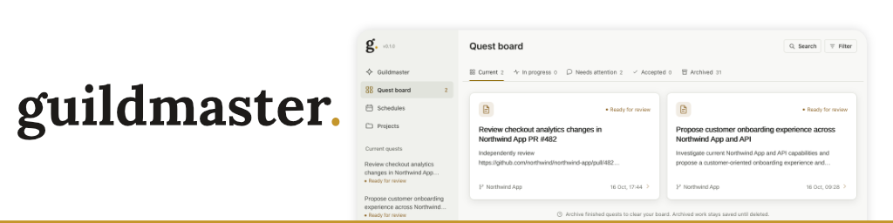

Guildmaster helps you manage work across AI agents. Give it a task, follow its progress, and return to the same conversation with feedback.

A **quest** is a task with its own conversation, workspace, and result. Its lead can delegate work to other agents and combine their findings. You decide when the result is done.

Use Guildmaster to:

- Review pull requests or investigate a codebase across several repositories.
- Make changes, inspect the result, and ask for revisions without starting over.
- Summarize Slack threads and identify work that needs your attention.
- Schedule recurring tasks, such as a morning brief or weekly project review.

You can paste images into conversations, inspect agent activity, and ask for follow-up quests. Agents need an explicit request to create follow-up quests.

Guildmaster runs locally in your browser. It uses the [Pi agent SDK](https://www.npmjs.com/package/@earendil-works/pi-coding-agent) and your model provider. You do not need to install the Pi CLI.

## Get started

You need Node.js 22.13 or later, npm, Git, and access to a supported model provider. Node.js 22 is the recommended version. macOS is the primary development platform. Other platforms are not yet validated.

```sh
git clone https://github.com/tomglenn/guildmaster.git
cd guildmaster
npm ci
npm start
```

Guildmaster builds the interface on its first start and opens [127.0.0.1:4173](http://127.0.0.1:4173).

1. Open **Settings** and connect a model provider.
2. Open **Settings → Models** and choose your model defaults.
3. For code tasks, add your local repositories in **Projects**, or ask Guildmaster to register them.
4. Tell Guildmaster what you want to do.

For example:

> Review the open pull requests in my Example App project. Identify the three that most need my attention. Do not change files or post reviews.

Slack is optional. Connect it through **Settings → Connections**. See [Slack setup](docs/connections.md) for access requirements and the sign-in flow.

## Day to day

The sidebar is your attention inbox. Open a quest to read its result, answer a question, or send feedback. When satisfied, select **Accept & close**; **Close** dismisses work without endorsing success. Retained quests appear in **Quest board → History** as **Accepted** or **Closed**. **Reopen** returns a quest to the inbox without starting work. Closing retains files, but starts the retention clock if automatic deletion is enabled. Existing enabled policies apply to all closed quests, including old closures. Reopening excludes the quest; closing it again starts a new clock.

The **Schedules** page holds recurring task instructions. Each run creates a normal quest. Schedules run while the service is running and your computer is awake.

Closing the browser or terminal leaves work running. These commands manage the local service:

```sh
npm run status
npm run stop
npm start
```

A service restart interrupts active work. Saved quests remain available, and you can resume interrupted quests from the interface.

## Model choices

**Settings → Models** has independent defaults for Guildmaster, quest leads, and subagents. Each choice includes the thinking settings supported by that model.

The existing Guildmaster chat picker updates the same saved choice. **New conversation** keeps that choice. Change it when Guildmaster is idle.

Expand **Use different models for specific work** to choose coding, writing, or adversarial review models. Quest leads use these preferences when delegating work. Project skills still define the workflow and permissions.

The adversarial review model is for independent challenges to work. Ordinary reviews can stay with the quest lead. Explicit adversarial requests use a fresh delegate with this preference; configuring it does not add mandatory review stages.

Existing quests and subagents keep their assigned model when resumed. Changed defaults apply to new assignments. Schedules save their lead and team choices separately from later global changes.

Unavailable models and unsupported thinking settings stop the run without a fallback. Conversations with images require an image-capable model. The SDK manages context compaction; Guildmaster does not count image bytes as tokens.

## Your data and access

Conversations, settings, and workspaces live in `~/.guildmaster`. Unsent drafts live in browser storage. Model requests send task context to your selected provider.

Agents use your local account and the tools available to their quest. Workspaces are not security sandboxes. Shell access can change files and external services. Publication consent relies on agent instructions, not a separate approval gate.

Guildmaster is an early local application. Use it with projects and accounts you are comfortable giving an agent access to.

## Development and help

- [Development](docs/development.md): hot reload, updates, tests, and troubleshooting.
- [Architecture](docs/architecture.md): the code map, quest lifecycle, and service boundaries.
- [Connections](docs/connections.md): Slack access and credentials.
- [Storage](docs/storage.md): saved data, backups, permanent deletion, and closed-quest retention.

For bugs, include reproduction steps and your Node.js version. Remove credentials, private conversations, and company information from logs or screenshots before sharing them.

## License

[MIT](LICENSE). Third-party attribution is in [THIRD_PARTY_NOTICES.md](THIRD_PARTY_NOTICES.md).
